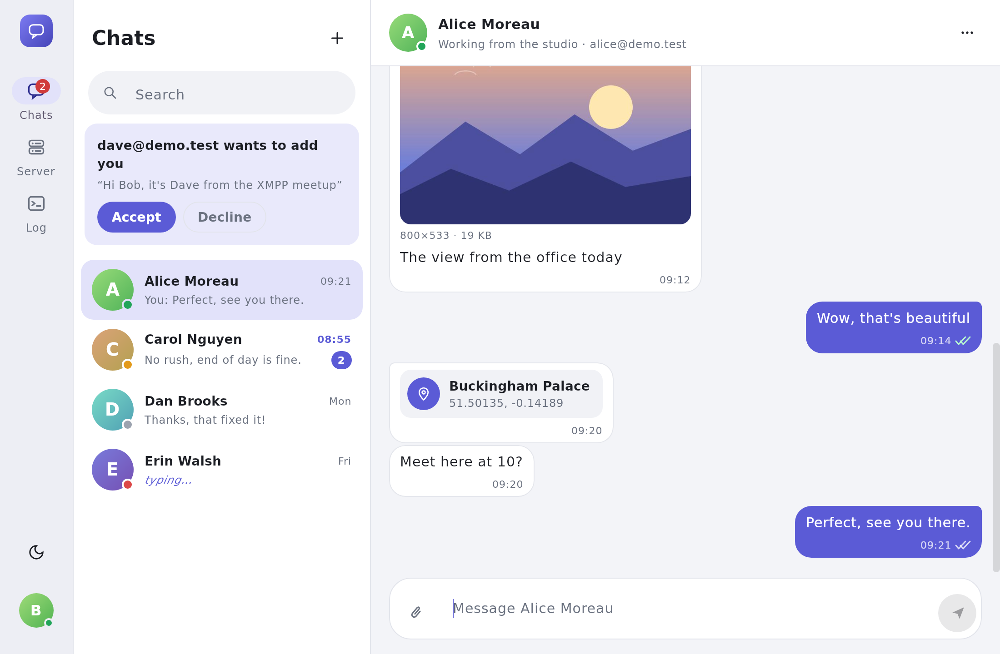
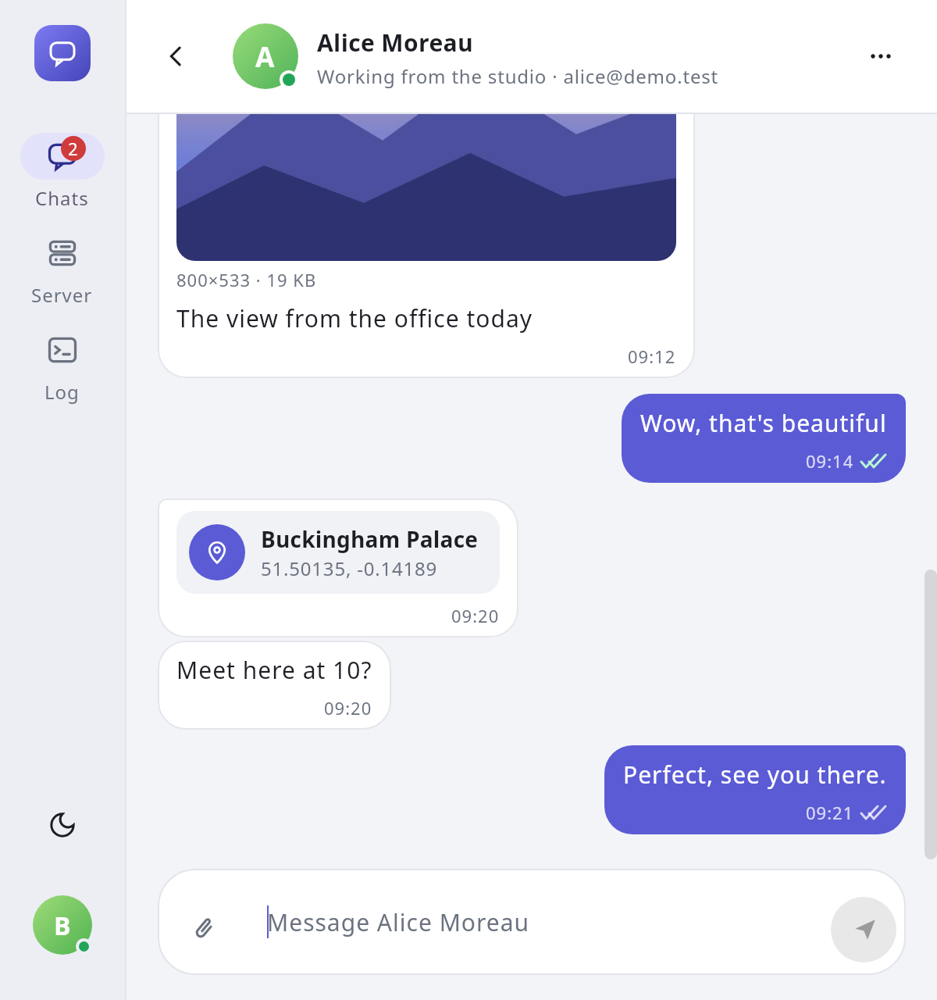
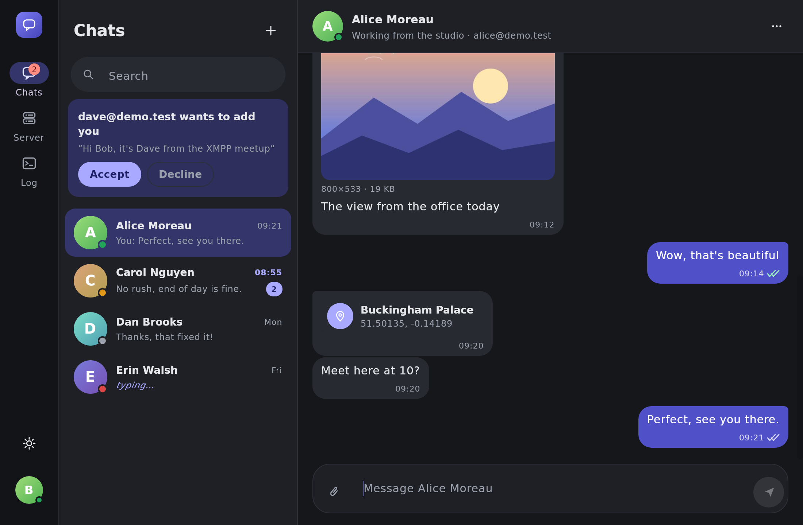
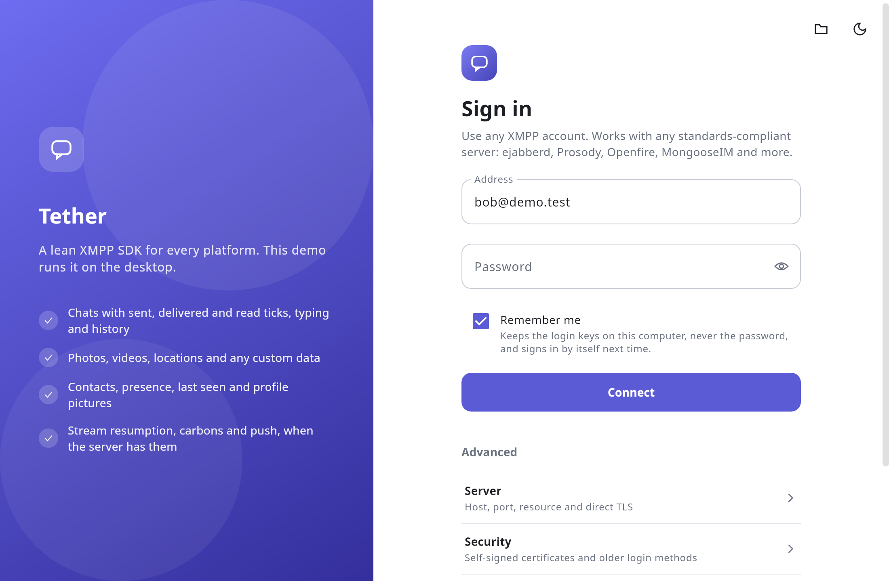

# Tether desktop demo

A small chat app for Linux, Windows and macOS that shows how to use the [Tether XMPP SDK](https://github.com/usmandurrany/tether-xmpp) on the JVM. It connects to any standards-compliant XMPP server (ejabberd, Prosody, Openfire, MongooseIM and others) and uses every part of the SDK:

| Screen | What it shows | SDK API |
| --- | --- | --- |
| Sign in | Address, password, optional host/port, direct TLS, trusting a self-signed certificate, PLAIN and SCRAM-SHA-1 opt-ins, "remember me" | `XmppConfig`, `TlsConfig`, `SaslConfig`, `TetherJvm.client`, `CredentialVault`, `FileKeyValueStore` |
| Account menu and banner | Live connection state, reconnecting, presence and status message, your profile, disconnect, log out | `XmppClient.state`, `Presences.set` / `hide` |
| Chats | Contacts with presence and last seen, unread counts, add/rename/remove, subscription requests (or auto-accept), messages with sent, delivered and read ticks, typing, history, delete for everyone and for me, contacts' names and pictures from their profiles | `TetherChat`, `ChatFeatures` |
| Attach | Photos, videos, locations and any custom type, sent as their own tags next to the caption and drawn on the other side | `MessageData`, `chat.send(to, text, data)`, `message.data("photo")` |
| Server | What the server offers on this session (Stream Management, carbons, archive, CSI, disco features), push registration | `XmppSession.capabilities`, `Carbons`, `Push` |
| Log | Every stanza sent and received, credentials always redacted, optional upload to a [tether-debug](https://github.com/usmandurrany/tether-debug) log portal | `TetherDebug`, `MemorySink`, `ConsoleSink`, `RemoteLogSink` |

The UI is [Compose for Desktop](https://www.jetbrains.com/compose-multiplatform/) with Material 3, light and dark. It adapts to the window: two panes when there is room, the chat list or one chat when it is narrow. Everything the SDK does lives in one file, [`DemoSession.kt`](src/main/kotlin/io/github/usmandurrany/tether/demo/DemoSession.kt); the rest only shows it.



| Narrow window | Dark theme | Sign in |
| --- | --- | --- |
|  |  |  |

More in [docs/screenshots](docs/screenshots).

### How the app is built

The app follows the same pattern as an Android Compose app, so it doubles as a template for a Compose chat client:

- **ViewModels with one state each.** `AppViewModel` signs in and out. Once signed in, `HomeViewModel`, `ChatsViewModel`, `ServerViewModel` and `LogViewModel` each `combine` the SDK's `StateFlow`s into one immutable `State` that the screen collects.
- **Routes and stateless screens.** Each screen has a `…Route` that gets its ViewModel and collects its state, and a `…Screen` that only takes that state and actions (`ChatsScreen(state, actions)`). The screens never see the SDK or a ViewModel, so tests and previews can draw them with any state.
- **One-way data flow.** Screens are functions of their state and report everything the person does through their actions. Problems that should show once (a failed delete, say) come through a `Channel` and appear in a snackbar.
- **Scoped to the session.** Each signed-in session gets its own `ViewModelStore`, so signing out clears the chat state with it (`ViewModelScope` in [`Main.kt`](src/main/kotlin/io/github/usmandurrany/tether/demo/Main.kt)).
- **No extra frameworks.** No DI container or navigation library: one session object is passed down, and the navigation rail switches between three screens.

| Package | What's in it |
| --- | --- |
| `demo` | `DemoSession` (all SDK calls), settings, files, attachments |
| `demo.app` | `AppViewModel`, the sign-in flow and the certificate prompt |
| `demo.ui.signin`, `ui.home`, `ui.chats`, `ui.server`, `ui.log` | One screen and its ViewModel each |
| `demo.ui.theme`, `ui.components` | Colours, type, icons and the shared building blocks |

## Run it

You need JDK 17 or newer and an internet connection. Nothing else: Gradle comes with the wrapper, and the first build fetches the SDK from GitHub and compiles it (see below). Compose's libraries come from Maven Central and Google's Maven repository.

```sh
git clone https://github.com/usmandurrany/tether-demo-desktop
cd tether-demo-desktop
./gradlew run            # Windows: gradlew.bat run
```

On Linux the app reads your display scaling (`GDK_SCALE`, `Xft.dpi` or GNOME's setting) because Java doesn't. If the UI still looks too small or too big, set it yourself: `java -Dsun.java2d.uiScale=2 -jar …`.

To hand it to a tester, build a single jar and run it with Java 17+ on the same kind of OS you built it on (Compose bundles the graphics library for that OS):

```sh
./gradlew packageJar
java -jar build/libs/tether-demo-desktop-0.1.0-all.jar
```

`./gradlew packageDistributionForCurrentOS` builds an installer with its own Java runtime: a `.deb` on Linux, an `.msi` on Windows and a `.dmg` on macOS, in `build/compose/binaries`.

CI builds the Mac app for you: every run of the Build workflow (on `main`, or started by hand on any branch) has a `tether-demo-macos` download with a `.dmg` for Apple Silicon Macs. The app is not signed, so macOS blocks it the first time. Drag it to Applications, try to open it once, then go to **System Settings > Privacy & Security** and press **Open Anyway**. Or, in Terminal:

```sh
xattr -dr com.apple.quarantine /Applications/tether-demo.app
```

## Connect to a server

1. Enter your address (`alice@example.com`) and password and press **Connect**. Most servers need nothing else: the server is found through the domain's DNS SRV records.
2. If the domain has no SRV records, or you reach the server by IP or another name, fill in **Host** (and **Port** if it isn't 5222). Tick **Direct TLS** for servers that take TLS from the first byte, usually on port 5223.
3. If the server uses a self-signed certificate, Connect shows its SHA-256 fingerprint and asks whether to trust it. Yes pins that certificate in **Trusted certificate**.
4. If the server only offers older login mechanisms, the error says so. Tick **Allow SCRAM-SHA-1** (Prosody 0.12 and other older servers) or **Allow PLAIN**. PLAIN is still only sent over verified TLS.

With **Remember me** on, the app keeps the SCRAM login keys (never the password) and signs in by itself on the next start. **Disconnect** keeps them; **Log out** deletes them.

Tether never connects without TLS.

## Photos, videos, locations and custom data

**Attach** in the chat sends a message with the SDK's custom data: a caption in the body, and the details as separate tags, for example a photo's link, size in bytes and dimensions. The other side reads them back and draws a photo, a video link or a map link. **Custom data** sends any type with any keys and values, and the receiver shows exactly what arrived. All of it is in [`Attachments.kt`](src/main/kotlin/io/github/usmandurrany/tether/demo/Attachments.kt):

```kotlin
chat.send(bob, "Look at this view", MessageData("photo", "url" to url, "width" to 800, "height" to 533, "size" to 48213))

val photo = message.data("photo")   // on the other side
photo?.string("url"); photo?.int("width")
```

The demo has no file hosting, so it sends links to photos and videos that are already online, and reads their size from the web server.

## Chat settings

- **Accept contact requests automatically** turns on `ChatFeatures(autoAcceptContacts = true)`. It is off by default, as in the SDK.
- **Profiles and pictures** turns `ChatFeatures.profiles` (vCard) on or off. It is on by default, as in the SDK. **Edit profile** in the account menu (your picture at the bottom of the left rail) edits your name, email, phone, "about" line and picture; a picked image is cropped square and made a 192×192 JPEG so it fits in one stanza.
- **Keep chats on this computer** uses the SDK's `FileMessageStore` (one file per account in `messages/`), so ticks, read state, deletions and photos survive a restart. **Log out** deletes the file.

## Where files go

| OS | Folder |
| --- | --- |
| Linux | `$XDG_CONFIG_HOME/tether-demo` (usually `~/.config/tether-demo`) |
| Windows | `%APPDATA%\TetherDemo` |
| macOS | `~/Library/Application Support/TetherDemo` |

`settings.properties` holds the sign-in page's settings (no password) and the theme. `messages/` holds each account's chats when **Keep chats on this computer** is on. `tether-state.properties` is the SDK's own state: stream resumption, unsent messages, keepalive timing, the roster and, with Remember me, the login keys. It is readable by your user only, but not encrypted. Pass `-Dtether.demo.home=<folder>` to use another folder, for example to run two accounts side by side:

```sh
./gradlew run -Pdemo.home=/tmp/bob
```

## Debug logging

The **Log** screen always shows the traffic. Under **Advanced** on the sign-in page you can also print it to the terminal, hide message bodies, and upload it to a tether-debug log portal (URL, ingest key and an optional label for the testing round). The portal groups uploads by an install id the app creates once.

## How the SDK is included

Tether is not on Maven Central yet, so Gradle builds it from its public repository, [usmandurrany/tether-xmpp](https://github.com/usmandurrany/tether-xmpp). [`settings.gradle.kts`](settings.gradle.kts) declares the repository as a Gradle source dependency: on the first build Gradle clones it into `.gradle/vcs-1` and compiles the JVM parts of the SDK (no Kotlin/Native or Android SDK needed); later builds reuse that copy. The app asks for the SDK by the same coordinates it will use once Tether is published, so moving to a released version only means deleting the `sourceControl` block:

```kotlin
implementation("io.github.usmandurrany.tether:tether-core")  { version { branch = "main" } }
implementation("io.github.usmandurrany.tether:tether-im")    { version { branch = "main" } }
implementation("io.github.usmandurrany.tether:tether-debug") { version { branch = "main" } }
```

The build follows the SDK's `main` branch. To try another branch, or to work on the SDK and the app together:

```sh
./gradlew run -Ptether.branch=my-branch          # another branch of tether-xmpp
./gradlew run -Ptether.sdkPath=../tether-xmpp    # your own checkout, rebuilt on every change
```

The log portal that **Log portal URL** uploads to is a separate project, [usmandurrany/tether-debug](https://github.com/usmandurrany/tether-debug), which you run yourself with Docker.

## The parts worth copying

- **One `TetherChat` per account.** `DemoSession.create` builds the client with `TetherJvm.client` and wraps it in a `TetherChat` with every feature on. The chat screen only reads `chat.conversations`, `chat.allMessages` and `chat.typingContacts`, and calls `send`, `typing`, `openChat`, `closeChat` and `loadOlder`. Ticks, read markers, typing timers, history and de-duplication are the SDK's job.
- **Desktop connection policy.** `BackgroundMode.STAY_CONNECTED`: the app stays connected when its window loses focus and only tells the server it is inactive (XEP-0352). Window focus drives `client.setForeground`.
- **Network changes.** The JVM has no network event, so the SDK's `TetherJvm.client` checks the interfaces every few seconds by itself (`JvmNetworkMonitor`) and reconnects when the network changes. The app writes no code for it.
- **First attempt versus reconnects.** `connect()` returns after the first attempt. The sign-in page stops on a failure and explains it; after a successful login, Tether reconnects on its own and a banner above the screen shows it.
- **Trusting a self-signed certificate.** A failed `connect()` carries `untrustedCertificate`, the refused certificate's fingerprint; the app asks, then retries with it pinned.
- **Not remembering a login.** `TetherJvm.client(rememberLogin = false)` saves no SCRAM keys and deletes old ones, while the SDK still saves its other state.
- **Read markers only while you can see the chat.** Window focus drives `client.setForeground`, and the SDK only marks an open chat read while the app is in the foreground.

## Tests

`ScreenshotTest` draws every screen with sample data into `build/screenshots`, off-screen, with no server or display. CI runs it on every pull request; run the Build workflow by hand on a branch to commit fresh pictures to [docs/screenshots](docs/screenshots).

`./gradlew test` also runs an end-to-end test against a real server when you give it two accounts, and is skipped otherwise:

```sh
TETHER_A_JID=alice@example.com TETHER_A_PASSWORD=... \
TETHER_B_JID=bob@example.com TETHER_B_PASSWORD=... \
./gradlew test
```

Add `TETHER_HOST` / `TETHER_PORT` when the domain has no SRV records, and `TETHER_ALLOW_SCRAM_SHA1=true` for servers that offer nothing newer. The test trusts a self-signed certificate the same way the app does. It covers the subscription handshake, presence, a message with its server ack, delivery receipt and read marker, history without duplicates, signing in again with saved keys, and log out.

## License

Apache License 2.0, like the SDK.
